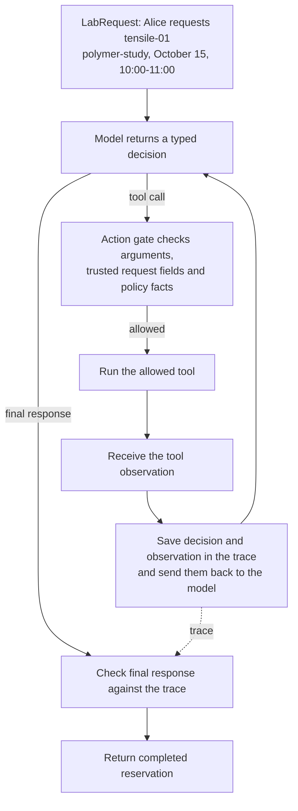

# Reservation flow

Example: `success_tensile` in `public_benchmark.json`.
The trusted `LabRequest` identifies Alice (`authenticated_user_id: alice`),
project `polymer-study`, resource `tensile-01`, start `2026-10-15T10:00:00`
and end `2026-10-15T11:00:00`.

The tools run one at a time in this order:

1. `search_lab_documents` returns the policy passages.
2. `get_user_authorizations` confirms Alice's project access and `lab_safety` qualification.
3. `get_resource_status` confirms availability, current calibration and no maintenance.
4. `reserve_resource` creates the reservation and returns a successful observation.

Before the reservation, the action gate checks the earlier observations. This
interval is daytime, so after-hours approval is not required. Only the reservation
tool changes simulator state; its trace event is marked as mutating.

The final check confirms that `TRN-210#tensile-tester` was retrieved and that
`reserve_resource` succeeded. The response has status `completed`, lists
`reserve_resource` in `completed_actions`, and ends with `model_finished`.
This run uses five model decisions and four tool calls. No denial or clarification
occurs in this example.
