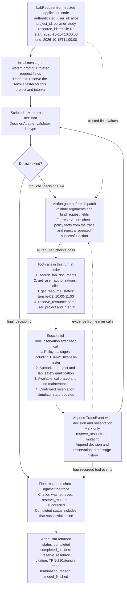

# Successful tensile tester reservation

This diagram follows `success_tensile` in `public_benchmark.json`.

Each trip around the loop executes one tool, not the entire numbered list at once.
Before the fourth call, the earlier observations establish policy retrieval,
project authorization, the required qualification, availability, calibration and
maintenance clearance. The requested 10:00-11:00 interval is daytime, so no
after-hours approval is required. All ten supplied reservation-context facts pass.

This scenario uses five model decisions and four tool calls, within the default
10-step budget. Retrieved text is untrusted content; the application checks the
recorded facts before dispatch and validates the final claims against the trace.
The denial and clarification branches are omitted because neither occurs in this
successful scenario.
